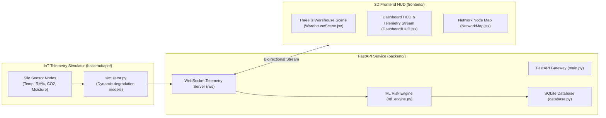

<div align="center">

# 🌾 GrainShield AI
### Real-Time Post-Harvest Silo Analytics & Spoilage Prediction Platform

<br/>

[](https://fastapi.tiangolo.com)
[](https://react.dev)
[](https://developer.mozilla.org/en-US/docs/Web/API/WebSockets_API)
[](https://threejs.org)

</div>

---

## 🌾 1. Operational Overview

Post-harvest grain spoilage during storage costs developing agricultural economies billions annually due to undetected moisture pockets, fungal mycotoxin outbreaks, and temperature spikes inside silos.

**GrainShield AI** is an IoT-ready digital twin and telemetry prediction platform designed for grain elevator operators and cold-storage managers. It combines:
1. **Real-time IoT Sensor Ingestion**: Multi-level temperature, relative humidity, $\text{CO}_2$ concentration, and grain moisture metrics streamed over low-latency WebSockets.
2. **3D Warehouse Digital Twin**: Interactive spatial Three.js warehouse rendering individual grain silos with color-coded risk heatmaps.
3. **Automated Spoilage Risk Engine**: Predicts remaining safe storage duration before mycotoxin thresholds trigger.

---

## 🏗️ 2. Architecture & Microservices



---

## 🛠️ 3. Technology Stack

* **Backend**: Python 3.10+, FastAPI, Uvicorn, WebSockets, SQLite, Pydantic.
* **Frontend**: React 18, Vite, Three.js (@react-three/fiber), Tailwind CSS, Lucide Icons.

---

## 🚀 4. Quickstart

### 1. Backend Service
```bash
cd Grainsheild/backend
python -m venv venv
.\venv\Scripts\Activate.ps1  # Windows PowerShell
pip install -r requirements.txt
python start_backend.py
```

### 2. Frontend 3D Dashboard
```bash
cd Grainsheild/frontend
npm install
npm run dev
```
Open **`http://localhost:5173`** to interact with the 3D grain silo digital twin.

---

## 🏷️ Repository Topics
`iot-telemetry` • `threejs` • `fastapi` • `agriculture-ai` • `digital-twin` • `websockets` • `react` • `spoilage-prediction`
